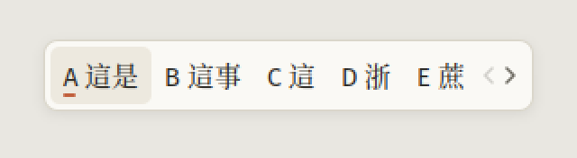
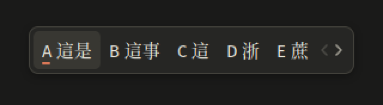

# 便箋 Notepaper

一個安靜的 fcitx5 候選窗主題：把候選窗想成放在紙上的小便條，暖白底、細邊框，只用一個陶土色點綴選中的候選字。有淺色和深色兩版，會跟著系統的深淺色自動切換。




- 候選字用明體（Noto Serif CJK TC Medium），序號、拼音和註解用無襯線體（Fira Sans）。
- 陶土色只出現在一個地方：選中候選序號下方的一條短線。
- 不用漸層、材質、模糊或動畫；陰影只淡到剛好讓便條浮起來。

設計細節、fcitx5 的限制和對應做法寫在 [DESIGN.md](DESIGN.md)。

## 需求

- fcitx5 5.1 以上，使用預設的 classic UI（在 Pop!_OS 24.04 + COSMIC + fcitx5 5.1.7 測試過）
- 字型：Fira Sans、Noto Serif CJK TC（Debian / Ubuntu 的 `fonts-noto-cjk-extra`）
- `python3-gi`：背景同步服務會用到；從原始碼重新產生主題還需要 Python 3.11 以上
- librsvg 的 gdk-pixbuf 載入器（`librsvg2-common`），fcitx5 才能讀 SVG 圖片
- systemd 使用者工作階段：用來執行深淺色同步服務（沒有也能安裝，只是 GTK、Qt 程式會一直是淺色，見下方）

## 安裝

### 從 Release 安裝（建議）

到 [Releases](https://github.com/NoWaY233851/fcitx5-notepaper/releases) 下載 `fcitx5-notepaper-<版本>.tar.gz`（不是 GitHub 自動附的 Source code），解壓縮後執行 `install.sh`：

```bash
tar xf fcitx5-notepaper-1.0.0.tar.gz
cd fcitx5-notepaper-1.0.0
./install.sh
```

安裝程式會把自己複製到 `~/.local/share/fcitx5-notepaper/` 再從那裡安裝，所以裝好之後，下載的檔案和解壓縮的資料夾都可以刪掉。

### 從原始碼安裝

```bash
git clone https://github.com/NoWaY233851/fcitx5-notepaper.git
cd fcitx5-notepaper
./install.sh
```

從 git checkout 安裝時，主題和服務都是**連結到這個資料夾**，改了 token 重新產生後會立刻生效，但**不能搬動或刪除這個資料夾**。如果搬了，在新位置重新執行一次 `./install.sh` 就好。

### 安裝時會做的事

1. 把淺色、深色主題連結到 `~/.local/share/fcitx5/themes/`。
2. 把字型別名 `60-notepaper.conf` 連結到 `~/.config/fontconfig/conf.d/`。這個別名定義了一個叫 `Notepaper` 的字族：先用 Fira Sans，缺字再用 Noto Serif CJK TC Medium。只有指名要 `Notepaper` 的程式會受影響。
3. 把字型、主題、深色主題等設定合併進 `~/.config/fcitx5/conf/classicui.conf`。第一次安裝前會把原本的檔案備份成 `classicui.conf.before-notepaper`。
4. 安裝並啟動 systemd 使用者服務 `notepaper-theme-sync`，讓 GTK、Qt 程式的候選窗也跟著深淺色切換。
5. 重新載入 fcitx5。如果字型別名是新的或剛改過，會直接重啟 fcitx5，因為 fcitx5 只在啟動時讀一次字型設定。

## 解除安裝

從 Release 安裝的：

```bash
~/.local/share/fcitx5-notepaper/install.sh --uninstall
```

從原始碼安裝的，在專案資料夾裡執行：

```bash
./install.sh --uninstall
```

它會停用並移除同步服務、移除三個連結，再還原安裝前的 `classicui.conf`（如果安裝前沒有這個檔案，就直接把它刪掉）。從 Release 安裝的，也會一併刪掉 `~/.local/share/fcitx5-notepaper/`。

## 自訂

所有顏色、尺寸和字型都在 [tokens.toml](tokens.toml)。改完之後：

```bash
python3 tools/build.py && ./install.sh
```

產生器只在內容真的改變時才會重寫檔案，所以只改顏色或尺寸的話，fcitx5 只會重新載入。改了 `[font]` 才會重啟 fcitx5。

改了字號的話，記得看一下陶土色短線還對不對得上序號：它的寬度是 `mark_width`，位置由 `mark_nudge_x`、`mark_offset_y` 決定，都不會跟著字號自動縮放。

## 注意事項

- **不要在 fcitx5 設定工具裡改字型。** 在 Fcitx 5 設定（`fcitx5-config-qt`）的字型選擇器裡選了別的字型並存檔，`Notepaper` 就會被換掉，漢字會變回黑體。萬一換掉了，重新執行 `./install.sh` 就能改回來。
- **GTK、Qt 程式的深淺色靠同步服務。** 在 COSMIC 這類沒有 `zwp_input_panel_v1` 的 Wayland 桌面上，Firefox、Qt 程式的候選窗是由 fcitx5-gtk / fcitx5-qt 在程式裡自己畫的。它們只讀 `classicui.conf` 的 `Theme=`，不認深色設定。`notepaper-theme-sync` 會在系統切換深淺色時改寫 `Theme=`，讓它們跟著換。這個服務平常在等系統通知，大約佔 9 MB 記憶體，閒置時不用 CPU。
- **Wayland 原生程式的候選窗會往右下偏幾個像素。** 依 fcitx5 5.1.7 的原始碼，它的 Wayland 視窗不會扣掉陰影的範圍，所以 Chrome、cosmic-term 這類程式裡，候選窗應該會往右偏 8px、往下偏 6px。X11 程式已經實測過不會偏。
- **fcitx5 5.1.18 以前不能把序號染色。** 所以陶土色是用序號下方的短線表示。之後升級 fcitx5，就可以改成直接把序號染成陶土色（見 [DESIGN.md](DESIGN.md) §8）。
- **COSMIC 的托盤選單不會套用這個主題。** COSMIC 的托盤選單是由面板自己畫的，不是 fcitx5。

## 截圖工具

`tools/snapshot.py` 會透過 DBus 建立一個假的輸入上下文、打幾個字，然後只擷取 fcitx5 候選窗本身的視窗，再鋪到指定的底色上。它不會截到螢幕上的其他內容。

```bash
python3 tools/snapshot.py --keys 5k4g4 --zoom 2 -o screenshots/dark.png
```

- `--keys` 要配合目前的 RIME 方案：注音用 `5k4g4`（這是），拼音用 `nihao`。
- `--inline-preedit`：假裝程式自己顯示預編輯，候選窗裡就只會有候選字。
- `--page`：候選窗底下的底色，預設是米色 `#E9E7E1`。

fcitx5-rime 預設讓所有視窗共用同一個 RIME 狀態，所以執行時 RIME 必須在中文模式。**也不要在打字打到一半時執行**，否則測試按鍵會接在你正在組的字後面，那段組字也可能被清掉。

## 專案結構

```
tokens.toml          顏色、尺寸、字型：唯一的事實來源
templates/           theme.conf、SVG、字型別名、classicui.conf 的模板
tools/build.py       從 tokens 和模板產生 dist/
tools/sync_theme.py  深淺色同步服務
tools/snapshot.py    截圖工具
tools/package.sh     打包 Release 用的 tar.gz
dist/                產生出來的主題（納入版本控制，可以直接用）
install.sh           安裝與解除安裝
DESIGN.md            設計說明、fcitx5 的限制與對策、已知限制
CLAUDE.md            給 Claude Code 的維護說明
```

## 授權

[MIT](LICENSE)
